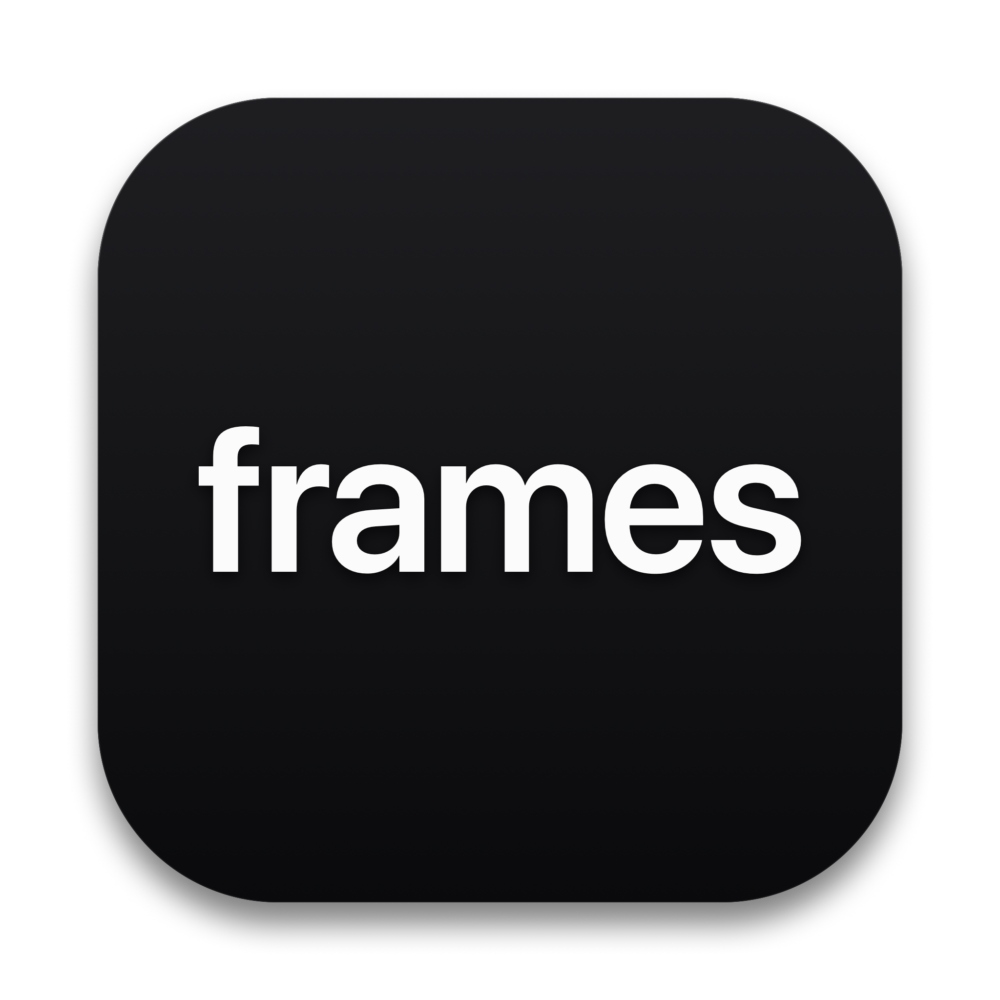

<p align="center">
  
</p>

<h1 align="center">Frames</h1>

<p align="center">
  <strong>A minimal, native macOS video player and media dashboard engineered specifically for Apple Silicon.</strong>
</p>

<p align="center">
  <a href="https://github.com/whoavidwivedi/frames/releases/latest"></a>
  
  
  
  
  
  <a href="https://github.com/whoavidwivedi/frames/pulls"></a>
  <a href="LICENSE"></a>
</p>

<p align="center">
  
</p>

---

## Overview

**Frames** is an ultra-fast, zero-bloat video player and media management dashboard built from the ground up for macOS and Apple Silicon. 

Traditional desktop video players are often weighed down by multi-hundred-megabyte Electron wrappers or legacy codebases dating back decades. Frames is written in pure **Swift and SwiftUI**, leveraging Apple Silicon's dedicated **VideoToolbox** media decoders and Unified Memory architecture to deliver fluid 60fps / 120fps playback, buttery timeline scrubbing, and sub-second cold starts with minimal battery drain.

The user interface adheres strictly to the **shadcn `mira`/`neutral`** dark design language: deep obsidian backgrounds (`#09090b`), crisp border contours (`#27272a`), refined typography, and unobtrusive liquid-glass playback controls.

---

## ⚡️ Download & Install

Download the latest pre-compiled binary from the [Releases](https://github.com/whoavidwivedi/frames/releases) page:

| Release | Version | macOS Architecture | Download |
| :--- | :--- | :--- | :--- |
| **Latest** | **v1.0.2** | Apple Silicon (`arm64`) | [**Frames-v1.0.2-macOS.zip**](https://github.com/whoavidwivedi/frames/releases/download/v1.0.2/Frames-v1.0.2-macOS.zip) |
| Previous | v1.0.1 | Apple Silicon (`arm64`) | [Frames-v1.0.1-macOS.zip](https://github.com/whoavidwivedi/frames/releases/download/v1.0.1/Frames-v1.0.1-macOS.zip) |
| Initial | v1.0.0 | Apple Silicon (`arm64`) | [Frames-v1.0.0-macOS.zip](https://github.com/whoavidwivedi/frames/releases/download/v1.0.0/Frames-v1.0.0-macOS.zip) |

1. Download and unzip `Frames-v1.0.2-macOS.zip`.
2. Move `frames.app` into your `/Applications` folder.
3. Open Frames and enjoy fluid hardware-accelerated playback.

---

## Key Features

### 1. Apple Silicon Hardware Acceleration
* **Zero-Copy VideoToolbox Decoding**: Hardware-accelerated decoding bypasses CPU cycles, piping decoded frames directly into Metal texture buffers.
* **ProMotion Display Synchronization**: Timeline scrubber and playhead update at the display's native refresh rate (up to 120Hz on ProMotion displays) without clock jitter or skipped frames.
* **Non-Blocking Chase-Seek**: Apple Chase-Seek queue prevents thread starvation and buffer stalls during rapid timeline dragging.
* **Energy Efficient**: Engineered to sip battery and keep thermals whisper-quiet with zero fan spin.

### 2. Media Dashboard & Library Sidebar
* **Folder Management**: Connect any folder on your Mac; subdirectories are recursively indexed asynchronously without blocking the UI.
* **Smart Organization**: Instant navigation across *All Videos*, *Recent*, *Favorites*, or custom pinned directories with live item counts.
* **Sub-Millisecond Search & Sort**: Filter thousands of titles instantly by name, date added, duration, or file size with keyboard focus management.
* **Adaptive View Modes**: Switch seamlessly between a 16:9 cinematic card grid and a compact list table.
* **Persistent Progress**: Remembers playback timestamps and resumes where you left off.

### 3. Native macOS Window & Fullscreen Architecture
* **Native Spaces Fullscreen (`⌃⌘F` / `F`)**: Full macOS Spaces immersion with automatic menu bar and dock suppression using the standard macOS shortcut `⌃⌘F` (or `F` during playback).
* **Windowed Desktop Fill / Zoom (`⌃⌥⌘F` / `Window -> Zoom`)**: Fills the current display space instantly without creating a new Space; accessible via macOS Zoom or `⌃⌥⌘F`.

### 4. Precision Subtitle Engine
* Seamless support for external `.srt` and `.vtt` subtitles via drag-and-drop or file picker.
* Real-time HTML tag stripping (`<i>`, `<b>`, `<font>`) and sub-millisecond timestamp parsing.

---

## Keyboard Shortcuts

Designed for native macOS and keyboard-first navigation:

| Key | Action |
| :--- | :--- |
| `Space` | Play / Pause |
| `←` / `→` | Seek backward / forward 5 seconds |
| `⇧←` / `⇧→` | Seek backward / forward 30 seconds |
| `.` / `,` | Frame step forward / backward |
| `↑` / `↓` | Volume adjust ($\pm 5\%$) |
| `M` | Toggle mute |
| `⌃⌘F` or `F` | Toggle native macOS fullscreen (macOS default) |
| `⌃⌥⌘F` / `Zoom` | Toggle windowed fullscreen / Zoom (macOS default) |
| `⌘M` | Minimize window (macOS default) |
| `⌘W` | Close window (macOS default) |
| `[` / `]` | Decrease / Increase playback rate ($\pm 0.1\times$) |
| `S` | Toggle subtitle track selector sheet |
| `I` | Toggle Apple Silicon hardware stats HUD |
| `⌘O` | Open video file(s) via native macOS dialog |
| `Esc` | Return to Dashboard / Exit Fullscreen / Resign Search |

---

## Testing & Optimization Suite

Frames includes a built-in test suite covering CoreGraphics math, subtitle parsers, Apple Silicon architecture checks, time formatting, and memory benchmarks.

Run tests directly from terminal:

```bash
./build/frames.app/Contents/MacOS/frames --run-tests
```

```
==========================================
       FRAMES TEST & OPTIMIZATION SUITE   
==========================================

[1] Testing TimeFormatting...
  ✔ PASS: Zero Seconds
  ✔ PASS: Seconds Under A Minute
  ✔ PASS: Minutes and Seconds
  ✔ PASS: One Hour and Above
  ✔ PASS: Negative Value Guard
  ✔ PASS: NaN Value Guard

[2] Testing SubtitleParser (SRT & WebVTT)...
  ✔ PASS: SRT Count
  ✔ PASS: SRT Cue 1 Timing
  ✔ PASS: SRT Cue 1 HTML Stripping
  ✔ PASS: SRT Cue 2 Timing
  ✔ PASS: WebVTT Count
  ✔ PASS: WebVTT Timing
  ✔ PASS: WebVTT Text

[3] Testing VideoMetadata...
  ✔ PASS: 4K Resolution String
  ✔ PASS: 1080p Resolution String
  ✔ PASS: 720p Resolution String
  ✔ PASS: Bitrate Description

[4] Testing AppleSiliconMetrics...
  ✔ PASS: Apple Silicon Detected
  ✔ PASS: Active CPU Cores
  ✔ PASS: Physical Memory Detected
  ✔ PASS: Display Refresh Rate Valid
  ✔ PASS: Low Memory Footprint (< 200MB)

[5] Testing Monotonic Time Interpolation...
  ✔ PASS: Time Interpolation Monotonicity (120fps Zero Jitter)

[6] Testing Shadcn mira/neutral Design Tokens & Scrubber Math...
  ✔ PASS: Shadcn Radius Scale (Sm=4, Md=6, Lg=8, Xl=10)
  ✔ PASS: Scrubber Zero Duration Division Guard
  ✔ PASS: Scrubber Seek Underflow Clamp
  ✔ PASS: Scrubber Seek Overflow Clamp

[7] Testing Subtitle Parser Performance Benchmark (1,000 cues)...
  ✔ PASS: 1,000 Cues Correctly Parsed
  ✔ PASS: 1,000 Cues Parse Latency < 100ms
  ✔ PASS: Active Cue Lookup at Time T

[8] Testing Apple Silicon Architecture & Unified Memory...
  ✔ PASS: ARM64 Architecture Verified
  ✔ PASS: Memory Footprint Under 150MB

[9] Testing Library & Dashboard Manager...
  ✔ PASS: Library Video Item Ingestion
  ✔ PASS: Duplicate Ingestion Guard
  ✔ PASS: Dashboard Search Filter
  ✔ PASS: Dashboard Favorites Filter
  ✔ PASS: Playback Progress Recorded (50%)
  ✔ PASS: Recent Timestamp Recorded

==========================================
RESULTS: 38 PASSED, 0 FAILED
==========================================
```

---

## Building from Source

### Prerequisites
* macOS 14.0 or higher
* Xcode 16.0 or higher with Command Line Tools
* Apple Silicon Mac (M1, M2, M3, M4 series)

### Build Commands

```bash
# 1. Clone the repository
git clone https://github.com/whoavidwivedi/frames.git
cd frames

# 2. Build Release configuration with xcodebuild
xcodebuild -project frames.xcodeproj -scheme frames -configuration Release build
```

---

## Contributing & Pull Requests

Contributions, feedback, and pull requests are warmly welcomed!

### PR Workflow
1. **Fork the repository** and create your branch from `main`:
   ```bash
   git checkout -b feature/your-feature-name
   # or
   git checkout -b fix/your-bug-fix
   ```
2. **Adhere to Code & Design Guidelines**:
   * Pure Swift & SwiftUI (no third-party package bloat).
   * Follow `shadcn` mira/neutral monochrome design tokens (`#09090b` obsidian backgrounds, `#27272a` borders).
   * Maintain **0 warnings and 0 errors** on Xcode builds.
3. **Verify Tests**:
   Ensure all 38 tests pass cleanly before submitting:
   ```bash
   ./build/Build/Products/Debug/frames.app/Contents/MacOS/frames --run-tests
   ```
4. **Submit a Pull Request**:
   Open a PR against the `main` branch with a clear summary of your changes.

---

## License

This project is open source and licensed under the [MIT License](LICENSE).
