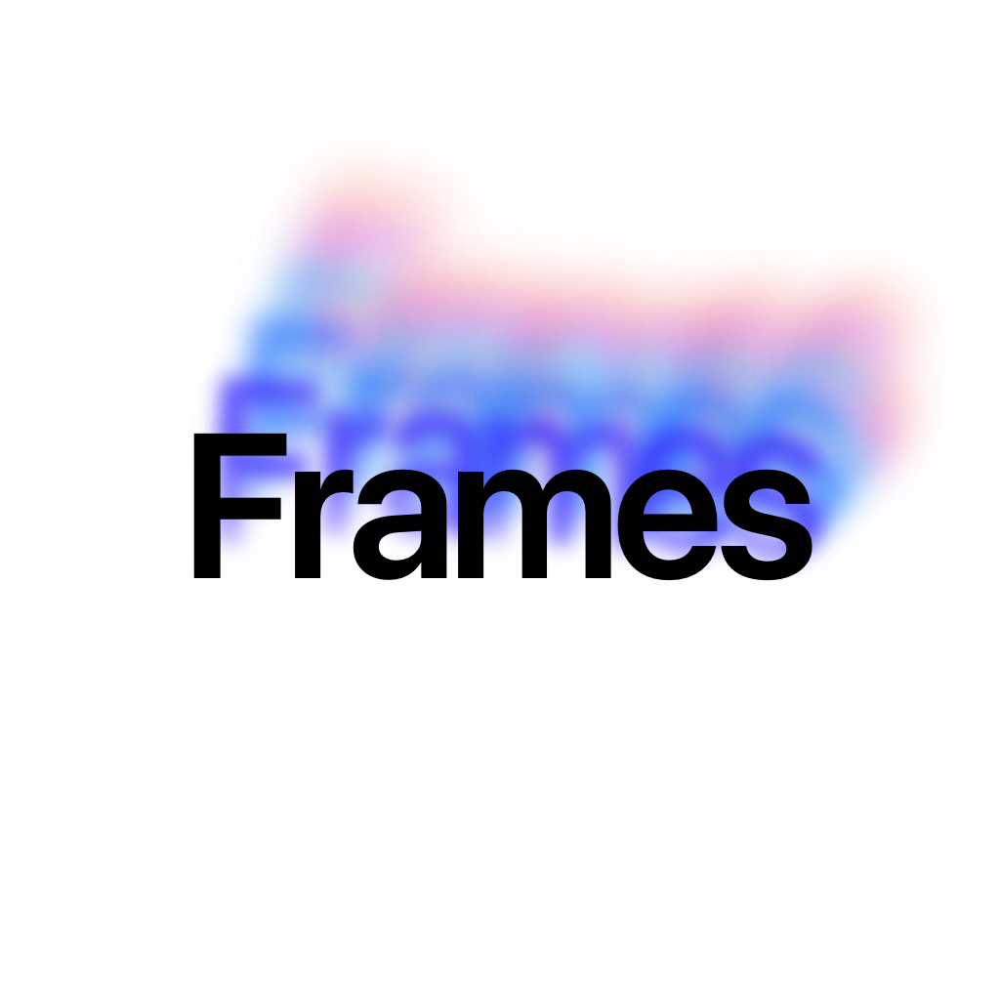
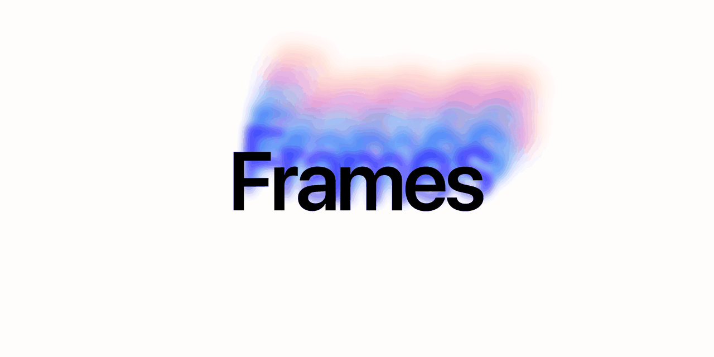

<p align="center">
  
</p>

<h1 align="center">Frames</h1>

<p align="center">
  <strong>A minimal, native macOS video player and media dashboard engineered specifically for Apple Silicon.</strong>
</p>

<p align="center">
  <a href="https://github.com/whoavidwivedi/frames/releases/latest"></a>
  <a href="https://github.com/whoavidwivedi/frames/actions/workflows/ci.yml"></a>
  
  
  
  
  
  <a href="https://github.com/whoavidwivedi/frames/pulls"></a>
  <a href="LICENSE"></a>
</p>

<p align="center">
  
</p>

In the app, the colored trails rise behind the centered wordmark on launch. The preview above loops the flow that follows.

---

## Frames 2.0

Frames is a native arm64 video player for macOS Golden Gate 27 and later. It uses first-party Swift container readers, VideoToolbox, Core Audio and native macOS presentation APIs. The player includes a folder library, resume history, external subtitles and keyboard transport controls.

| Container | Playback path |
| --- | --- |
| MP4, MOV, M4V | Native ISO media reader with AVFoundation fallback |
| MKV, WebM | Native Matroska reader |
| AVI | Native Motion JPEG support, including compatible PCM audio |
| IVF | VP9 and AV1 video on systems providing a suitable decoder |
| Other media | AVFoundation attempts playback using the installed macOS codecs |

Codec profile, hardware, and display capabilities affect resolution, HDR and decoding. Comparative battery life and maximum sustained playback resolution have yet to be benchmarked.

## Installation and updates

Download the installer from [GitHub Releases](https://github.com/whoavidwivedi/frames/releases/latest), or run the installer from the repository.

```bash
/bin/bash -c "$(curl -fsSL https://raw.githubusercontent.com/whoavidwivedi/frames/main/scripts/install.sh)"
```

The installer verifies the archive checksum, bundle identity, version and signature. Ad-hoc builds require consent. If macOS blocks first launch, select **System Settings → Privacy & Security → Open Anyway** for Frames. Use **Frames → Check for Updates** for subsequent updates. Users on v1.9.4 or v1.9.5 can use the release’s migration installer.

## Keyboard Shortcuts

Designed for native macOS and keyboard-first navigation:

| Key | Action |
| :--- | :--- |
| `Space` | Play / Pause |
| `←` / `→` | Seek backward / forward 5 seconds |
| `⇧←` / `⇧→` | Seek backward / forward 30 seconds |
| `.` / `,` | Frame step forward / backward |
| `↑` / `↓` | Volume adjust ($\pm 5\%$) |
| `M` | Toggle mute |
| `⌘S` | Capture high-resolution video frame snapshot |
| `⌘K` | Open Command Palette |
| `⌘,` | Open Preferences / Settings |
| `⌃⌘F` or `F` | Toggle native macOS fullscreen (macOS default) |
| `⌃⌥⌘F` / `Zoom` | Toggle windowed fullscreen / Zoom (macOS default) |
| `⌘M` | Minimize window (macOS default) |
| `⌘W` | Close window (macOS default) |
| `[` / `]` | Decrease / Increase playback rate ($\pm 0.1\times$) |
| `S` | Toggle subtitle track selector sheet |
| `I` | Toggle Apple Silicon hardware stats HUD |
| `⌘O` | Open video file(s) via native macOS dialog |
| `Esc` | Return to Dashboard / Exit Fullscreen / Resign Search |

---

## Testing

Run the Xcode test scheme and the isolated installer regression suite from the repository root. The engineering guide includes the commands, playback fixture criteria, performance measurement procedure and release workflow. [Engineering guide](AGENTS.md)

## Building from Source

### Prerequisites
* macOS 27.0 or higher
* Xcode 16.0 or higher with Command Line Tools
* Apple Silicon Mac (M1, M2, M3, M4 series)

### Build Commands

```bash
# 1. Clone the repository
git clone https://github.com/whoavidwivedi/frames.git
cd frames

# 2. Build Release configuration with xcodebuild
DEVELOPER_DIR=/Applications/Xcode.app/Contents/Developer xcodebuild \
  -project frames.xcodeproj \
  -scheme frames \
  -configuration Release \
  -destination "platform=macOS,arch=arm64" \
  -derivedDataPath ./build/DerivedData \
  build
```

---

## Contributing & Community

Contributions, feedback, and pull requests are warmly welcomed!

- Read our [Contributing Guidelines](CONTRIBUTING.md) for details on code style, branch workflows, and PR verification.
- Review our [Code of Conduct](CODE_OF_CONDUCT.md) for community standards.
- Check our [Security Policy](SECURITY.md) for responsible vulnerability reporting.

---

## License

This project is open source and licensed under the [MIT License](LICENSE).
